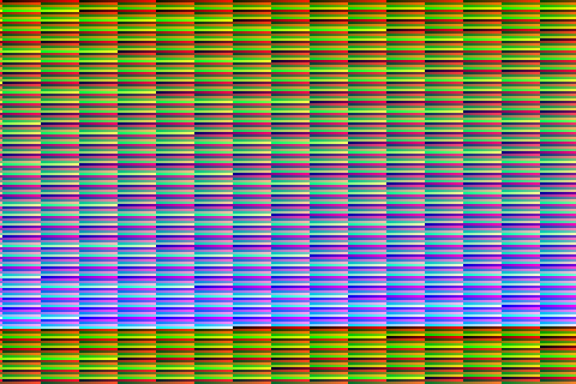

# Open Pocket GBA

Experimental native FPGA Game Boy Advance work for the **Sipeed Tang Nano 20K (GW2AR-18)**,
based on [Open Pocket GBC](https://github.com/LakoMoor/open-pocket-gbc).
The original project history, GBC target and infrastructure are preserved.

**This is not a complete GBA implementation.** The current target executes an
original ARM/Thumb diagnostic in hardware RTL, uses SDRAM for GBA RAM/VRAM,
implements timers, keypad and LCD status/IRQ, and drives 240x160 RGB555 at 3x through the
existing 720x480 HDMI pipeline. CPU IRQ/SWI return, memory handshakes and complete
output frames have been checked in Verilator. Native CPU performance, a compatible
BIOS, full PPU, DMA, audio, cartridge saves and the GBA menu are still missing.



This image is a simulated HDMI RGB capture, not a physical board demonstration.
See [confirmed progress and build results](docs/gba-progress.md),
[architecture audit](docs/gba-architecture.md), [memory/bandwidth budget](docs/gba-memory-budget.md)
and [compatibility limits](docs/gba-compatibility.md).

## Build and test

Only open-source tools: Yosys + slang, nextpnr-himbaechel, Apicula/gowin_pack,
Verilator and openFPGALoader. No mandatory Gowin EDA dependency.

```sh
python fw/gba/make_diagnostic.py
bash sim/gba/run.sh
bash sim/gba/board.sh
./build.sh gba_top
```

Override `TOOLS` to point to OSS CAD Suite; the existing Windows default is
`/e/tools/oss-cad-suite`. GBA build artifacts and timing logs go into
`build/gba_top/`. GBA timing failures prevent packing a bitstream.

The original Game Boy / Game Boy Color target remains separate:

```sh
./build.sh gbc_top
```

Its features, menu, firmware, wiring and flash instructions are documented in
[the preserved GBC README](README.gbc.md). `flash.sh` continues to select GBC;
it does not implicitly install GBA or change the existing firmware/save layout.

## Source and licensing

The console runs as FPGA logic, not software emulation on a RISC-V CPU or PC.
Only the CPU/Thumb decoder is imported from GBATang; the integration, memory
system, timer/IRQ module and diagnostic are separate work. Attribution and full
license texts are in [licenses](licenses/gba-provenance.md) and [LICENSE](LICENSE).
No proprietary BIOS or commercial ROM is included. The diagnostic's original
source and explicit instruction encodings are in `fw/gba/make_diagnostic.py`.
